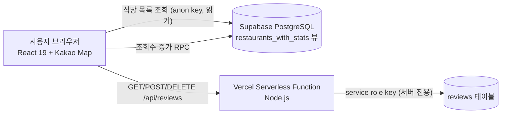

# 🍽️ 조대 후문 가성비 맛집 지도 (Chosun Food Map)

> 조선대학교 후문 가성비 식당을 **지도 위에서 가격·별점으로 한눈에 비교**하고, 로그인 없이 익명 리뷰를 남길 수 있는 웹 서비스

[](http://kwangju.co.kr/article.php?aid=1779183000799171028)


-3FCF8E?logo=supabase&logoColor=white)


| 항목 | 내용 |
| --- | --- |
| 개발 기간 | 2026.05.09 ~ 2026.06.06 (첫 커밋 당일 배포, 4일 만에 식당 13곳 데이터 구축 후 기능 고도화) |
| 개발 인원 | 1인 (기획 · 현장 데이터 수집 · 프론트엔드 · 서버리스 API · DB 설계 · 배포) |
| 성과 | 학우들의 실제 불편을 해결한 서비스로 **광주일보 인터뷰 보도** |

---

## 📖 왜 만들었나

고물가로 학식 대안을 찾는 학생은 많지만, 포털 지도에는 대학가 소규모 식당 정보가 **중복되거나 가격이 빠져 있거나 위치가 어긋난** 경우가 많았습니다.
"후문에서 만 원 이하로 먹을 수 있는 곳"을 빠르게 찾으려면 여러 앱을 오가야 했습니다.

그래서 **가격을 지도 마커에 바로 띄우는 것**을 핵심으로 잡았습니다. 식당을 하나씩 눌러보지 않아도 지도만 보면 가격과 별점이 비교되도록 만들었습니다.

## ✨ 주요 기능

| 기능 | 설명 |
| --- | --- |
| **가격·별점 마커** | 커스텀 오버레이 마커에 대표 가격과 평균 별점을 상시 표시, 선택·hover 시 강조 |
| **마커 클러스터링** | 지도를 축소하면 `MarkerClusterer`로 마커를 묶어 겹침 방지 |
| **카테고리 필터 · 정렬** | 데이터에서 카테고리를 동적으로 추출해 필터 칩 생성, 별점순 / 가격 낮은순 정렬 |
| **인기 맛집 랭킹** | 식당 상세 조회수 기준 TOP 4를 상단에 노출 |
| **익명 리뷰** | 로그인 없이 별점 · 상황별 태그 · 한줄평 작성, 본인 리뷰만 원클릭 삭제 |
| **어뷰징 방지** | 같은 식당에는 하루(KST) 1회만 리뷰 작성 가능 (서버에서 검증) |
| **모바일 우선 UI** | 모바일은 지도/목록 상하 분할 + 바텀시트 상세, 데스크톱은 좌측 목록 + 우측 지도 |

## 🏗 아키텍처



- **읽기 전용 데이터**(식당 목록, 평균 별점, 조회수)는 브라우저가 Supabase에서 직접 조회합니다.
- **쓰기 작업**(리뷰 작성·삭제)은 반드시 서버리스 함수를 거칩니다. DB 쓰기 권한이 있는 `service role key`는 서버 환경변수에만 있고 브라우저 번들에는 포함되지 않습니다.

## 🛠 기술 스택

| 구분 | 기술 |
| --- | --- |
| Frontend | React 19, Vite, Tailwind CSS, react-kakao-maps-sdk |
| Backend | Vercel Serverless Functions (Node.js), bcryptjs, date-fns-tz |
| Database | Supabase (PostgreSQL) |
| Infra | Vercel (SPA rewrite + `/api` 라우팅) |

---

## 💡 기술적 의사결정과 문제 해결

### 1. 로그인 없는 익명 리뷰에서 "도배"를 막는 방법
**문제** — 회원가입을 요구하면 참여율이 떨어지고, 아무 제약이 없으면 한 사람이 리뷰를 도배할 수 있었습니다.

**해결** — 서버리스 API에서 **요청자 IP를 해시한 값 + 식당 ID + 오늘(KST) 날짜**로 작성 이력을 확인해, 같은 식당에 하루 두 번째 리뷰는 `429 Too Many Requests`로 거절합니다.

```js
// api/reviews.js — 같은 IP가 오늘 이 식당에 남긴 리뷰가 있으면 거절
const { count } = await supabase.from('reviews')
  .select('id', { count: 'exact', head: true })
  .eq('hashed_ip', hashedIp)
  .eq('restaurant_id', restaurantId)
  .gte('created_at', startOfTodayKstIso())
if ((count ?? 0) >= 1) return json(res, 429, { error: '같은 식당에는 하루에 한 번만 …' })
```

- **IP 원문은 저장하지 않습니다.** SHA-256에 서버 비밀 값(pepper)을 섞어 해시한 값만 저장해, DB가 유출돼도 IP를 역추적하기 어렵게 했습니다.
- "오늘"의 기준이 서버 위치(UTC)에 따라 달라지지 않도록 **KST 자정을 UTC 시각으로 변환**해 비교합니다.
- 클라이언트도 서버가 내려준 KST 날짜로 잠금 상태를 저장해, 이미 작성한 날에는 버튼 자체를 숨깁니다(서버 검증이 최종 방어선).

### 2. 비밀번호 입력 없이 "내 리뷰만" 삭제하기
**문제** — 익명 게시판처럼 삭제용 비밀번호를 직접 입력하게 하면 작성 단계가 늘어나고, 사용자가 비밀번호를 잊어버립니다.

**해결** — 작성 시 브라우저가 4자리 비밀번호를 자동 생성해 서버로 보내고, 서버는 **bcrypt 해시만 저장**합니다. 원본은 작성자 기기의 localStorage에만 남겨, 같은 기기에서는 "삭제" 버튼 하나로 지울 수 있습니다. 서버는 삭제 요청마다 해시를 비교해 권한을 확인합니다.
리뷰 조회 API는 `password_hash` 컬럼을 select 대상에서 제외해 응답에 섞여 나가지 않게 했습니다.

### 3. 실제 쿼리에 맞춘 인덱스 설계
리뷰 테이블에서 실제로 실행되는 쿼리는 두 가지뿐이라, 각각에 맞는 복합 인덱스를 만들었습니다.

| 쿼리 | 인덱스 |
| --- | --- |
| 식당별 리뷰 목록 (최신순) | `(restaurant_id, created_at DESC)` |
| 1일 1회 작성 제한 확인 | `(hashed_ip, restaurant_id, created_at)` |

별점은 DB `CHECK (rating BETWEEN 1 AND 5)` 제약과 서버 검증으로 이중으로 막았습니다. ([schema-reviews.sql](supabase/schema-reviews.sql))

### 4. 리뷰 작성 UX를 "탭 몇 번"으로 줄이기
작성 폼을 처음엔 닉네임·비밀번호·별점·본문 입력으로 만들었다가, 실제로 써 보니 단계가 많아 다음처럼 바꿨습니다.

- 닉네임은 `조대미식가_1234` 형태로 자동 생성 (수정 가능)
- 비밀번호 입력 제거 (위 2번 방식)
- 본문 대신 **상황별 태그 18개**(`#공강시간활용`, `#가성비최고`, `#혼밥` 등)를 3개 그룹으로 나눠 탭으로 선택, 한줄평은 선택 사항
- 모바일에서는 바텀시트 모달로 열리고 폼 영역만 스크롤

### 5. 지도 위 마커 겹침
후문 상권은 식당이 수십 미터 간격으로 붙어 있어 가격 마커끼리 겹쳤습니다. 축소 시에는 **마커 클러스터링**으로 묶고, 확대 상태에서도 겹치는 몇몇 식당은 **시각적 오프셋**을 줘서 가격이 가려지지 않게 했습니다.

### 6. 직접 방문해 검증한 데이터
포털 데이터를 그대로 쓰지 않고 식당 13곳을 직접 방문해 **대표 메뉴 가격, 인원별 가격 조건, 정확한 좌표**를 확인해 정리했습니다. JSON으로 관리하던 데이터는 [uploadData.js](uploadData.js) 스크립트로 좌표 유효성을 검사한 뒤 Supabase로 이관했습니다.

---

## 📂 프로젝트 구조

```
├── api/
│   └── reviews.js            # Vercel Serverless: 리뷰 조회/작성/삭제 API
├── supabase/
│   └── schema-reviews.sql    # 리뷰 테이블 · 제약조건 · 인덱스
├── src/
│   ├── App.jsx               # 지도, 목록, 필터/정렬, 인기 랭킹, 상세 패널
│   ├── components/
│   │   ├── RestaurantReviews.jsx  # 리뷰 목록 · 작성 모달 · 삭제
│   │   └── AdSense.jsx            # 콘텐츠 로드 후에만 광고 렌더링
│   ├── lib/reviewsApi.js     # API 오리진 설정 (로컬/배포 분기)
│   └── data/restaurants.json # 현장 검증한 식당 원본 데이터 (13곳)
├── uploadData.js             # JSON → Supabase 일괄 이관 스크립트
└── vercel.json               # SPA rewrite (/api 제외)
```

## 🚀 로컬 실행

```bash
npm install
cp .env.example .env   # Kakao, Supabase 키 입력
npm run dev            # http://localhost:3000
```

리뷰 API까지 로컬에서 확인하려면 [Vercel CLI](https://vercel.com/docs/cli)로 `vercel dev`를 실행하거나, `.env`의 `VITE_API_ORIGIN`에 API 서버 주소를 지정합니다.

## 🔭 회고와 다음 단계

- **조회수 중복 방지가 클라이언트에만 있음** — 현재는 localStorage로 하루 1회만 RPC를 호출합니다. 리뷰처럼 서버(RPC 내부)에서 IP 해시 기준으로 막는 것이 다음 개선 과제입니다.
- **IP 기반 제한의 한계** — 같은 와이파이를 쓰는 학생들은 같은 IP로 묶이고, 반대로 네트워크를 바꾸면 우회가 가능합니다. 사용 규모가 커지면 기기 식별 토큰이나 간편 인증을 함께 쓰는 방향을 검토하고 있습니다.
- **DB 객체의 코드화** — `restaurants` 테이블, `restaurants_with_stats` 뷰, `increment_visit_count` 함수는 Supabase 대시보드에서 만들어 저장소에 SQL이 없습니다. 마이그레이션 파일로 버전 관리할 예정입니다.
- **테스트** — 리뷰 API의 검증·제한 로직부터 단위 테스트를 추가할 계획입니다.
